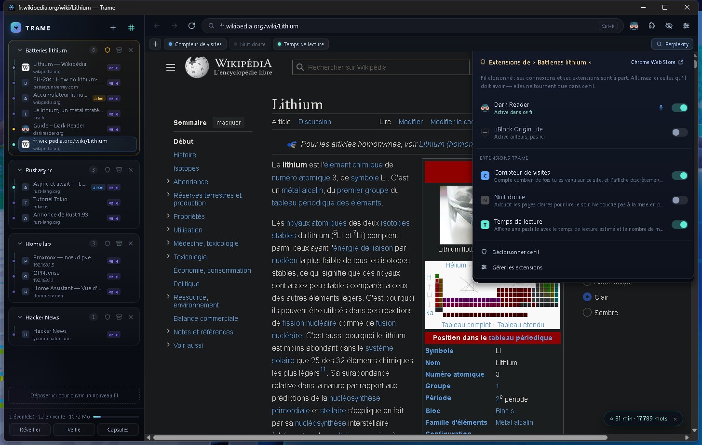
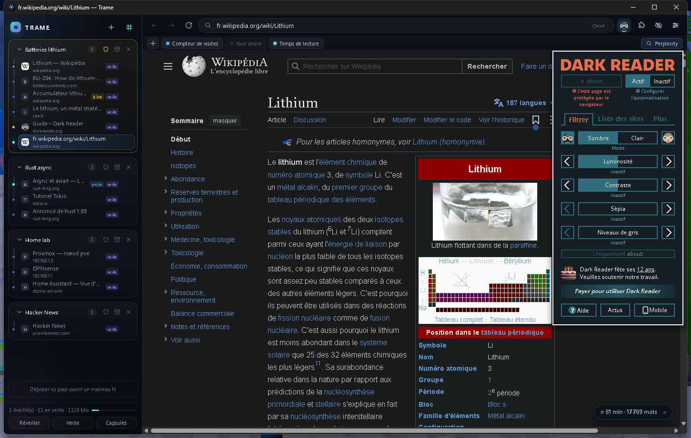
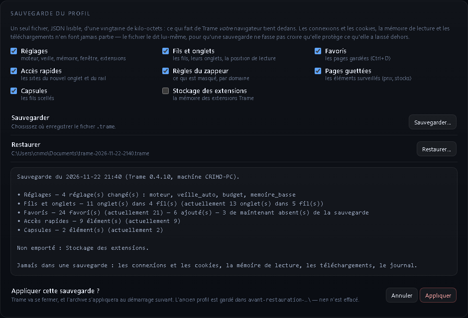
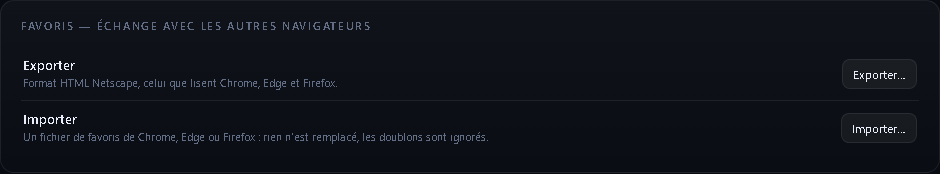

# Trame

**Un navigateur à onglets tissés, écrit en Rust.** Coquille `tao` + `wry` sur WebView2, interface
en HTML local, moteur d'extensions à manifeste.

> Un onglet n'est pas un document ouvert : c'est **un fil d'attention**. Trame mesure ce fil,
> l'affiche, l'endort quand il refroidit — et ne ferme jamais rien.


> **Le cours des évolutions** (ce qui a été construit, corrigé et vérifié, dans l'ordre) :
> [`docs/EVOLUTIONS.md`](docs/EVOLUTIONS.md). Les mesures de performance et les optimisations
> (faites ou refusées) : [`docs/OPTIMISATIONS.md`](docs/OPTIMISATIONS.md).

Le menu des extensions et la fenêtre d'une extension épinglée se posent **par-dessus la page**,
comme dans Chrome : la page ne bouge pas, reste visible autour, et un clic dessus referme la
fenêtre. La fenêtre d'une extension prend la taille de son contenu.





---

## Lancer

```powershell
cd D:\LIFE\10-projets\en-developpement\trame
cargo run --release
```

Prérequis : Rust stable (testé 1.94.1 MSVC), WebView2 Runtime (présent sur Windows 11),
Windows 10/11.

Le profil vit dans `%LOCALAPPDATA%\Trame` (`session.json`, `history.jsonl`, `ext-storage.json`,
`capsules\`, `extensions\`, `trame.log`). `TRAME_PROFIL` permet d'utiliser un autre dossier —
c'est ainsi que les essais se font sans toucher au profil réel.

```powershell
# essai sur un profil jetable, avec une session de démonstration
node outils/graine-session.mjs .profil-demo
$env:TRAME_PROFIL = "$PWD\.profil-demo"; cargo run
```

### Ajouter un fil d'onglets à un profil existant

```powershell
# Fermer Trame d'abord : la session est réécrite à l'arrêt.
node outils/ajouter-fil.mjs "$env:LOCALAPPDATA\Trame" outils/home-lab.json
```

`outils/home-lab.json` contient les adresses réelles du home lab, **vérifiées le 2026-11-21**
(port ouvert + réponse HTTP). Les onglets sont ajoutés **en veille** : treize services coûtent
zéro mémoire tant qu'on n'en ouvre pas un. Un fil de même nom déjà présent est remplacé.

## Ce qu'il fait

| Mécanisme | Ce que ça change |
|---|---|
| **Les fils** | Chaque onglet rejoint un fil — jamais par domaine seul : provenance (l'onglet parent), domaine, proximité lexicale des titres, fraîcheur du fil. Un fil a un nom, une durée de vie, et survit aux redémarrages. |
| **Ranger les fils** | On glisse la tête d'un groupe (nom, compteur) au-dessus ou au-dessous d'un autre : un trait dit où il tombera. L'ordre est celui de `session.fils`, donc il tient au redémarrage et les deux vues restent d'accord — les cartes du rail et les bandes de la trame. Déposer sur sa propre place ne demande rien à l'hôte. |
| **La vitalité** | Score continu par onglet : il monte quand vous y revenez, décroît avec le temps (demi-vie 8 min). Affiché comme un nœud lumineux sur la chaîne du fil. **Il ne déplace jamais un onglet** : la position acquise est stable. |
| **La mémoire basse** | Avant la veille, un palier : un onglet ouvert mais caché depuis 20 s rend sa RAM au système (WebView2 `MemoryUsageTargetLevel = Low`) sans se fermer, et revient à la normale au clic. Mesuré : −94 à −192 Mo de RAM avec 5 onglets cachés (`docs/OPTIMISATIONS.md` § 1.4). |
| **La mémoire libre** | Le nombre d'onglets ouverts est un plafond : sous 1,5 Go libre sur le PC, les plus froids s'endorment (jamais sous 2, jamais l'onglet affiché), et le pied du rail le dit (§ 1.5). |
| **Le coût des extensions** | Le puzzle et les réglages disent ce que chaque extension coûte en mémoire : mesuré en direct, ou par différence à son allumage (§ 1.6). |
| **La veille** | Sous le seuil, la webview est **détruite** (pas gelée) : la mémoire revient, l'onglet reste, un clic le réveille à sa position de lecture. Plafond de webviews vivantes par défaut : 6. |
| **La trame** (Ctrl+Espace) | Vue tissée : chaque fil est une bande, le temps va de gauche à droite, la taille d'un nœud dit la vitalité, un trait relie un onglet à celui d'où il vient. Glisser un nœud sur une bande le tisse dans ce fil. |
| **La Couture** (Ctrl+K) | Une seule saisie : onglets, fils, historique, commandes (`>`), ou adresse. Le classement mêle pertinence textuelle, **vitalité** et fraîcheur. |
| **Les fils cloisonnés** (bouclier dans l'en-tête d'un fil) | Un fil peut avoir **son propre profil** : connexions, cookies et **extensions** à part. Bitwarden seulement dans le fil « Comptes », uBlock partout ailleurs ; un compte ouvert dans la cloison ne l'est pas dans les autres fils. Le puzzle d'un fil cloisonné montre les extensions **de ce fil**. WebView2 n'active une extension que pour un profil entier, jamais pour un onglet : c'est donc la seule façon honnête d'avoir des extensions par fil. Prouvé par le scénario `t` (cookie invisible, extension présente ou absente selon le fil). |
| **Les capsules** | Un fil entier scellé dans un fichier JSON : URL, titres, position de lecture, mise de côté. Déplaçable, partageable, réouvrable. |
| **Le clic droit d'un onglet** | Tout ce qu'on peut faire de cet onglet, au même endroit : **fermer**, **fermer les autres du fil** (le fil, pas tout le navigateur — `Ctrl+Maj+T` rouvre), **dupliquer** (même fil, juste à côté), mettre en veille ou réveiller, recharger, couper ou remettre le son, **ancrer** (il ne refroidit jamais), **à lire plus tard**, **ajouter le site aux accès rapides**, **copier l'adresse** et **copier le titre**, déplacer vers un fil, un rendez-vous, une fermeture différée. Un onglet qui n'est pas affiché reçoit ces lignes-là seulement ; celles de la page (favori, impression, guet, côte à côte, navigation privée) restent à l'onglet affiché, et le menu le dit. |
| **La navigation privée** (bouton `Privé` du pied du rail, entrée du Nouvel onglet, menu de la page, ou `Ctrl+Maj+N`) | Un fil à part, avec **son propre profil WebView2 jetable** : ses connexions et ses cookies ne sont pas ceux du navigateur, ses onglets ne sont **jamais** écrits dans `session.json`, rien n'entre dans l'historique ni dans la mémoire de lecture, et le profil est effacé au démarrage suivant (dossier **et** entrée dans le `Local State` de Chromium). Trois entrées visibles — une touche qu'on ne connaît pas n'existe pas. Éprouvé par `node outils/eprouver-prive.mjs` (cookie compris : posé dans la session privée, il n'existe plus après) et `node outils/eprouver-entrees.mjs` (les entrées cliquées dans le vrai binaire). |
| **La sauvegarde automatique** | Une archive `.trame` écrite toute seule dans un dossier choisi, toutes les N heures (1 h à 7 jours), sans rien demander. Rotation : les plus anciennes partent **après** l'écriture de la nouvelle, et seulement celles dont le nom a exactement la forme que Trame écrit (`Trame-AAAA-MM-JJ-HHhMMmSS.trame`) — un fichier de l'utilisateur n'est jamais touché. Sans dossier choisi, rien ne part. |
| **La barre d'extensions** | Sous la Couture : une pastille par extension (clic = activer/désactiver, **choix retenu au redémarrage**), un `＋` pour ouvrir le dossier, et le **moteur de recherche courant** à droite. Masquable depuis les réglages. |
| **Les réglages** (`Ctrl+,`) | Une vraie page interne (`trame://reglages`) : moteur de recherche parmi huit, gestion des extensions, veille et budget mémoire, historique, chemins du profil. Tout est enregistré à la volée dans `reglages.json`. |
| **Les extensions** | `manifest.json`, scripts de contenu, CSS, API `chrome.storage.local` persistante. Trois exemples livrés. |
| **Le menu de la page** (`⋯` à droite de la barre, ou clic droit sur un onglet du rail) | Tout ce qui s'applique à la page affichée : favori, impression, recherche, rendez-vous, fermeture programmée, côte à côte, guetteur, mémoire de lecture. |
| **Les favoris** (étoile dans la barre, `Ctrl+D`) | Une étoile pleine = page en favori. Ils sortent dans la barre dès qu'on tape leur nom, et en tuiles sur la page « Nouvel onglet ». Stockés dans `favoris.json`. |
| **Ouvrir dans le fil** (`Alt+Entrée` dans la barre) | L'adresse tapée s'ouvre dans un **nouvel onglet du fil où l'on est**, juste sous la page en cours, au lieu de la remplacer. `Entrée` seul garde son comportement. |
| **Le côte à côte** (`Maj+Entrée`, ou `Maj+clic` sur un onglet) | Deux pages dans la même fenêtre ; la séparation se fait glisser (20 à 80 %). La page neuve prend la place de celle qu'on **ne lit pas** : la page lue ne change jamais de côté. Le menu dit où l'on va — **« À gauche »** / **« À droite »** — et le clic droit sur un onglet du rail, pendant un côte à côte, propose **« Remplacer la page de gauche »** ou **« … de droite »**. Un clic dans une page la rend active. Option « défilement lié » pour comparer deux pages de même forme. |
| **Les rendez-vous** (menu de la page) | « Dans 1 h », « ce soir », « demain matin », « ce week-end », « lundi » : l'onglet **quitte le rail et s'endort** (zéro mémoire), puis revient seul à l'heure dite, marqué « revenu », avec un clignotement dans la barre des tâches. Une ligne en bas du rail liste ceux qui attendent. |
| **La fermeture programmée** | « Se ferme dans 1 h / 3 h / ce soir » : l'onglet part tout seul (`Ctrl+Maj+T` le rouvre). |
| **Le guetteur** (menu de la page → « Guetter un élément ») | On désigne un prix, un stock, un résultat : Trame relit la page **toutes les 30 min dans une page cachée et muette**, détruite aussitôt la lecture faite, jamais quand le PC manque de mémoire. Si le texte change : message « 39,90 € → 34,90 € », clignotement dans la barre des tâches, pastille sur `⋯`. Stocké dans `guets.json`. |
| **La mémoire de lecture** (`?` dans la barre) | Une page restée affichée 8 s est gardée **sur ce PC** (texte seul, 12 000 caractères au plus, 1 500 pages au plus). `? électrolyte solide` retrouve la page où vous l'avez lu, avec le passage. Jamais les pages qui ont un champ de mot de passe ; un site peut être exclu (et ce qui en avait été gardé est effacé) ; tout s'efface depuis les réglages. Le fichier (`lectures.jsonl`) n'est relu que pendant une recherche, par un fil à part : rien en mémoire vive. |
| **Le zappeur** (icône œil barré) | Panneau de droite : on désigne un élément dans la page (ou l'on colle un sélecteur CSS) et il disparaît. Règles **par domaine**, relisibles, coupables, supprimables, stockées dans `zap.json`. Livré avec 9 règles YouTube (Shorts, annonces) et 3 règles génériques. |
| **La sauvegarde** (`Ctrl+,` → Sauvegarde du profil) | Un fichier JSON d'une vingtaine de kilo-octets qui emporte ce que vous cochez (réglages, fils, favoris, accès, zappeur, guets, capsules) et **ne prend jamais** les connexions, la mémoire de lecture ni les téléchargements — le fichier écrit pourquoi. La restauration simule d'abord ce qu'elle changerait, garde l'ancien profil dans `avant-restauration-…\`, et s'applique au démarrage suivant. |
| **L'aide** (`F1`, bouton `?` de la barre, menu `⋯` → Notice) | Une **Notice** (`trame://localhost/aide.html#<fiche>`) : 14 fiches, chacune dit à quoi sert la fonction, les façons de la lancer, et propose « Essayer maintenant ». `F1` ouvre la fiche de ce qu'on regarde (côte à côte ouvert → Côte à côte, vidéo sortie → Vidéo flottante). La **Couture répond aux questions** (« split écran », « sortir la vidéo »), `Ctrl+/` affiche **tous les raccourcis**, des **astuces** sortent au bon moment (une par jour au plus, jamais deux fois la même, coupables), et la notice existe en **PDF** (bouton de la Notice, menu Démarrer). Tout vient d'une seule source : `ui/notice.js`. |
| **Les favoris en HTML** | Export et **import** au format Netscape : celui que lisent Chrome, Edge et Firefox. Sans l'import, un export ne servirait qu'à partir. |

### Moteur de recherche

Huit moteurs au choix : **Perplexity** (défaut), Google, DuckDuckGo, Brave Search, Qwant,
Startpage, Ecosia, Bing. Les gabarits forcent la langue française quand le moteur l'accepte
(`kl=fr-fr`, `hl=fr&gl=fr`, `setlang=fr&cc=FR`) — sans cela, un moteur peut choisir sa langue
d'après l'adresse réseau et répondre en anglais. Le badge « fr » dans les réglages signale les
moteurs concernés.

> Le titre de l'onglet vient **du site** : « aliexpress at DuckDuckGo » est le titre de la page
> de résultats, pas une chaîne de Trame. Notre seule prise est la langue forcée dans l'URL et
> le moteur choisi.

### Raccourcis

| Touche | Effet | Touche | Effet |
|---|---|---|---|
| `Ctrl+T` | nouvel onglet | `Ctrl+W` | fermer l'onglet |
| `Ctrl+Maj+T` | rouvrir le dernier fermé | `Ctrl+K` / `Ctrl+L` | la Couture |
| `Ctrl+Espace` | la trame | `Ctrl+B` | replier le rail |
| `Ctrl+R` / `F5` | recharger | `Ctrl+Tab` | onglet suivant |
| `Ctrl+,` | réglages | `Ctrl+1…9` | onglet n° n |
| `Ctrl+ +` / `Ctrl+ -` | zoom avant / arrière (par onglet) | `Ctrl+0` | zoom à 100 % |
| `Ctrl+F` | chercher dans la page | `F12` | inspecteur (build debug) |
| `Ctrl+D` | ajouter / retirer des favoris | `Ctrl+P` | imprimer ou enregistrer en PDF |
| `Alt+Entrée` (barre) | ouvrir dans un nouvel onglet du fil | `Maj+Entrée` (barre) | ouvrir à côté de la page |
| `Maj+clic` (rail) | afficher l'onglet à côté | clic droit (rail) | menu de cette page |
| `F1` | la Notice, sur la fiche de ce qu'on regarde | `Ctrl+/` | tous les raccourcis |
| `Alt+P` | vidéo seule, par-dessus tout | `Alt+Maj+P` | vidéo dans une fenêtre à part |

Le zoom et la recherche dans la page sont **par onglet** : grossir un article ne grossit pas la
banque en ligne, et la barre de recherche se referme sur `Échap` en rendant le clavier à la page.

**Téléchargements** : un fichier demandé par une page va dans `%LOCALAPPDATA%\Trame\telechargements\`
(jamais écrasé — `rapport (2).pdf` au besoin), et l'application l'annonce. Sans ce branchement,
WebView2 ouvrait son propre panneau, invisible ici : le clic ne produisait rien.

## Sauvegarde, restauration, échange de favoris



**Un fait commande tout le reste.** Mesure du 2026-11-22 sur le profil de Clément :
**1 217 Mo et 10 204 fichiers**. Dedans, ce qui fait que Trame est *ce* navigateur pèse **19 Ko** :

| Ce qui définit le navigateur | Poids | Ce qui pèse | Poids |
|---|---|---|---|
| `session.json` (fils, onglets, positions) | 6,2 Ko | `webview2\EBWebView` (cookies, connexions) | **854,6 Mo** |
| `zap.json` | 4,7 Ko | `telechargements\` | 283,8 Mo |
| `favoris.json` | 3,3 Ko | `extensions-chrome\` | 77,6 Mo |
| `capsules\` (2 fils scellés) | 2,4 Ko | `lectures.jsonl` (texte des pages lues) | 489,9 Ko |
| `acces.json` | 1,3 Ko | `trame.log` | 415,6 Ko |
| `ext-storage.json` | 0,7 Ko | `history.jsonl` | 16,6 Ko |
| `reglages.json` | 0,6 Ko | | |

**Le rapport est de 1 à 64 000.** Une sauvegarde utile emporte donc la colonne de gauche — un
fichier qu'on s'envoie par mail — et laisse la droite dehors **en le disant** : le fichier
contient la liste de ce qu'il n'a pas pris, avec la raison (clé `exclus`). Une sauvegarde qui ne
dit pas ce qu'elle a omis fait croire qu'elle protège ce qu'elle n'a pas pris.



| Ce qu'elle fait | Ce qu'elle ne fait pas |
|---|---|
| Un fichier `.trame` : du **JSON lisible**, avec sa `version`, sa date **locale**, la version de Trame, la machine et une **empreinte SHA-256** du bloc de données | Emporter les connexions et les cookies : une session ouverte est un secret |
| Une case par contenu : réglages · fils et onglets · favoris · accès rapides · zappeur · guets · capsules · stockage des extensions (décochée par défaut) | Emporter la mémoire de lecture (le texte de ce que vous avez lu), ni les téléchargements, ni le journal |
| **Restaurer en simulant d'abord** : ce qui change, ce qui est ajouté, ce qui manque à l'archive | Écrire quoi que ce soit avant votre confirmation |
| **Garder l'ancien profil** dans `avant-restauration-<date>\` avant d'écrire | Effacer quoi que ce soit — jamais |
| S'appliquer **au démarrage suivant** : Trame se ferme, et une ligne du journal le dit | Restaurer `webview2\`, même si une archive le contient : refusé, avec le motif |
| **Exporter et importer les favoris en HTML** (format Netscape, celui de Chrome, Edge, Firefox) | Importer les *dossiers* de favoris de Chrome : tout arrive dans une seule liste |

**Pourquoi la restauration passe par un redémarrage.** Trame réécrit `session.json` à son arrêt.
Restaurer depuis la fenêtre ouverte serait effacé quelques secondes plus tard par la sauvegarde de
sortie. La commande écrit `restauration-en-attente.json`, ferme Trame, et c'est le démarrage
suivant qui applique l'archive — **avant** que la session ne soit lue et avant que le moteur
WebView2 ne soit créé. Rien n'est appliqué à moitié, et l'ancien profil reste sur le disque.

Deux pièges rencontrés, et ce qu'ils ont appris :

- **`serde_json` trie les clés de tous les objets**, imbriqués compris (sa `Map` est une
  `BTreeMap`). L'empreinte se calcule donc sur une forme canonique ; un outil qui la recalcule
  sans trier les clés imbriquées trouve une empreinte différente. Ce n'est qu'un
  **avertissement** au journal, jamais un refus : le fichier reste du JSON qu'on peut corriger à
  la main.
- **Sauvegarder sans avoir écrit la session** aurait ignoré les onglets ouverts dans les
  dernières secondes — `session.json` n'est réécrit qu'à l'arrêt, ou toutes les 8 s. La commande
  matérialise l'état avant de lire le disque.

**Ce qui reste ouvert, dit franchement** : il n'y a pas de sauvegarde **automatique** (à date
fixe, dans un dossier choisi) ; et l'export HTML aplatit les dossiers de favoris.

## Où vit quoi

Tout ce dont le navigateur a besoin vit sous **`%LOCALAPPDATA%\Trame\`** (le profil). Rien ne dépend
de l'endroit où se trouve l'exécutable, et un `cargo clean` ne peut plus effacer une connexion.

```
%LOCALAPPDATA%\Trame\
├── ui\                        interface (miroir de la version livrée, mis à jour au démarrage)
├── extensions\                extensions Trame (amorcées une seule fois, modifiables)
├── extensions-chrome\         extensions Chrome actives
├── extensions-chrome-desactivees\   coupées, pas chargées
├── extensions-chrome-archives\      retirées ou remplacées — jamais effacées
├── webview2\EBWebView\        profil WebView2 : cookies, connexions, service workers
├── telechargements\           fichiers téléchargés (jamais écrasés)
├── capsules\                  fils scellés
├── session.json               onglets, fils, position
├── history.jsonl              historique (5000 entrées max)
├── reglages.json              moteur, veille, budget, état des extensions, épinglages
├── favoris.json               favoris (Ctrl+D) — une page, pas un site
├── acces.json                 accès rapides (sites, groupes, bande du rail)
├── guets.json                 éléments surveillés (prix, stocks)
├── lectures.jsonl             mémoire de lecture : le texte des pages lues
├── telechargements.json       liste des téléchargements
├── zap.json                   règles de masquage
├── ext-storage.json           stockage des extensions Trame
├── extensions-chrome-sources.json   d'où vient chaque extension
├── extensions-livrees.json    quelles extensions livrées ce profil a déjà reçues
├── trame.log                  journal
├── trame.lock                 verrou de profil (un seul Trame par dossier)
├── avant-restauration-<date>\ copie de ce qui allait être écrasé par une restauration
├── restauration-en-attente.json     archive confirmée, à appliquer au démarrage suivant
└── derniere-restauration.json       compte rendu, lu une fois par l'interface
```

Six de ces fichiers ne figuraient pas dans cette arborescence avant le 2026-11-22, alors qu'ils
existent bel et bien : c'est exactement ce qui rendait impossible la réponse à « qu'est-ce que je
dois sauvegarder ? ». La liste des contenus d'une sauvegarde vit maintenant dans
`src/sauvegarde.rs` (`CONTENUS`), et un test la compare aux chemins du profil.

**Pourquoi Local et pas Roaming.** Un profil de navigateur est une donnée de machine, pas de
compte : 355 Mo de caches, de cookies et de profils WebView2 n'ont rien à faire dans un dossier
itinérant, où ils suivraient chaque ouverture de session d'un poste à l'autre. Le profil vivait
dans Roaming par héritage ; il a été **déplacé** vers Local au premier démarrage (déplacement du
dossier entier, pas copie), et l'ancien n'existe plus.

Trois précisions, parce qu'elles ont coûté quelque chose :

- **L'interface est un miroir.** Un fichier retiré de la livraison disparaît du profil — une
  vieille copie de `chrome.js` avait déjà masqué un correctif. Un fichier identique n'est pas
  réécrit : un démarrage normal ne touche à rien.
- **Le profil WebView2 a été rapatrié**, pas recréé : au premier démarrage de cette version, les
  273 Mo de `trame.exe.WebView2` (à côté de l'exécutable) ont été copiés dans `webview2\`, et
  l'ancien dossier renommé `.migre` au lieu d'être supprimé. La connexion Bitwarden a survécu.
- **`TRAME_PROFIL` déplace tout** : c'est ce que les tests utilisent pour ne jamais toucher au
  vrai profil.

## Installer Trame

Deux livrables, produits par `node outils/faire-setup.mjs` et rangés dans `dist\` :

| Fichier | Pour qui |
|---|---|
| `Trame-<version>-setup.exe` (~2,8 Mo) | installation par utilisateur : `%LOCALAPPDATA%\Programs\Trame`, raccourci menu Démarrer, entrée « Applications », désinstalleur. **Aucun droit administrateur.** |
| `Trame-<version>-portable.zip` (~1 Mo) | sans installation : décompresser, lancer `trame.exe`. À replacer à côté de `ui\` et `extensions\`. |

`SHA256SUMS.txt` donne les empreintes des deux fichiers.

**Les deux sont signés** avec Azure Trusted Signing (compte `domoteek`, profil `MesApps`), via
l'outil partagé de l'écosystème `_tools\signature\signer.ps1` — le même que pour HydraNext. La
signature est horodatée (DigiCert) et `Get-AuthenticodeSignature` répond **Valid**, signataire
`CN=CAHAGNE CLEMENT`. L'ordre compte : **l'exécutable est signé avant la compilation du setup**,
sinon le client installe un exe non signé sous un setup signé.

> **0.4.75, publiée et installée le 2026-11-27.** Premier morceau du **VPN** : le **portier**.
> Réglages → Confidentialité → **Tunnel (VPN)** : « Exiger un tunnel avant de naviguer ». Allumé et
> sans tunnel monté, Trame **refuse** d'ouvrir un site — il affiche une page qui explique, avec
> « Réessayer » — au lieu de laisser passer le trafic en clair. Les pages internes (réglages, nouvel
> onglet) et la boucle locale restent joignables, sinon on ne pourrait plus éteindre l'exigence.
> La détection lit les cartes que Windows décrit (`GetAdaptersAddresses`) : type *tunnel*, ou nom
> connu (WireGuard, Wintun, TAP, OpenVPN, VPN…), et **seulement si la carte est montée**. Preuves :
> `cargo test` **231/231**, `tester-ui` **107/107**, `outils/eprouver-tunnel.mjs` sur le vrai binaire
> (page du tunnel affichée, aucun document du site chargé, réglages toujours accessibles, portier
> éteint → l'adresse s'ouvre). Le tunnel lui-même (WireGuard embarqué + service compagnon) reste à
> faire.
>
> **0.4.74, publiée et installée le 2026-11-27.** Après la 0.4.73, la vidéo en plein écran n'était
> plus plantée mais restait **« beuguée »** — l'affichage plein écran du lecteur dans une fenêtre
> normale — et la fenêtre **sautait**. Cause : le moteur garde son propre état de plein écran, et
> Trame en sortait pour montrer le nouvel onglet **sans le lui dire** ; les deux états divergeaient.
> Trois corrections : un lien reçu de Windows s'ouvre **en arrière-plan** quand une page est en plein
> écran (elle le garde), Trame **prévient la page** quand il en sort vraiment (et avant de changer
> d'onglet, car une page en arrière-plan n'a plus le droit d'en sortir elle-même), et un **garde-fou
> d'1,5 s** empêche de rentrer dans le plein écran qu'on vient de quitter. Preuves : `cargo test`
> **227/227**, `tester-ui` **105/105**, `outils/eprouver-plein-ecran-telechargement.mjs` (plein écran
> « écran », celui de Clément).
>
> **0.4.73, publiée et installée le 2026-11-27.** Un lien de **téléchargement** (fichier `.exe` sur
> Discord) ouvert par Trame laissait un onglet **noir** : la navigation *est* le téléchargement, donc
> aucune page n'arrivait jamais — et l'onglet restauré au démarrage **retéléchargeait** le fichier à
> chaque fois. Mesuré : le fichier survit à la fermeture de l'onglet (24 Mo complets), mais pas si on
> ferme trop tôt (0 octet reçu). L'onglet ouvert **pour** un fichier se referme donc **dès que des
> octets coulent** ; une **page** qui navigue vers un fichier, elle, reste et revient en arrière.
> Preuves : `cargo test` **227/227**, `tester-ui` **105/105**, `outils/eprouver-telechargement-onglet.mjs`
> (16 Mo entiers, onglet refermé, aucun onglet de fichier en session).
>
> **0.4.72, publiée et installée le 2026-11-26.** Depuis une recherche Google, le même article
> s'ouvrait dans **deux** onglets (celui d'origine ayant même le bon historique). Mesuré : le motif
> des moteurs et des boutiques est `window.open(url)` puis, la fenêtre étant refusée, `location.href =
> url` — le site navigue donc lui-même, et Trame ouvrait **en plus** un onglet. Une fenêtre demandée
> par une page ne crée plus d'onglet : elle s'ouvre **dans l'onglet d'où vient la demande**, et une
> demande sans adresse ne fait rien. Conséquence assumée : un lien `target="_blank"` remplace la page
> courante (Retour y ramène) au lieu d'ouvrir un onglet. Preuves : `cargo test` **226/226**,
> `tester-ui` **105/105**, `outils/eprouver-onglet-fenetre.mjs` (4 motifs, 1 seul onglet, aucun
> doublon).
>
> **0.4.71, publiée et installée le 2026-11-26.** « Sur une recherche Google, cliquer un résultat me
> crée un onglet alors qu'il n'y a pas besoin ». Mesuré : un site qui demande une fenêtre **vide**
> (`window.open()`) puis écrit dedans retombe sur la navigation de la page courante (la fenêtre est
> refusée) — et Trame créait malgré tout un onglet blanc, inutile. Une demande **sans adresse** ne
> crée plus d'onglet ; un lien `target=_blank` et un `window.open(adresse)`, eux, ouvrent un onglet
> avec leur adresse, comme Chrome. Preuves : `cargo test` **226/226**, `tester-ui` **105/105**,
> `outils/eprouver-onglet-fenetre.mjs` sur le vrai binaire.
>
> **0.4.70, publiée et installée le 2026-11-26.** « J'ouvre un raccourci YouTube, la flèche de retour
> est déjà active ; retour, retour → `about:blank` ». Mesuré : l'historique de l'onglet était
> `["about:blank", <la page>]`, parce que la webview naît sur une page blanche (c'est ce qui évite la
> page inerte) et que le premier chargement **ajoutait** une entrée au lieu de la remplacer. La
> première navigation passe désormais par `location.replace` : l'historique commence à la vraie page,
> « Retour » reste inactif tant qu'il n'y a rien de vrai derrière. Preuves : `cargo test` **226/226**,
> `tester-ui` **105/105**, `outils/eprouver-retour-onglet.mjs` (CDP `Page.getNavigationHistory`).
>
> **0.4.69, publiée et installée le 2026-11-26.** « Dès que je mets un côte à côte ça la met à
> droite, et celle de gauche ne se remplace jamais » — mesuré : la paire était recalculée à chaque
> fois comme `(page active, page neuve)`, donc « gauche » n'était pas un endroit mais « la page où
> j'étais ». Désormais la page neuve prend la place de celle qu'on **ne lit pas** (la page lue ne
> change jamais de côté), le menu dit les deux côtés — **« À gauche »** / **« À droite »** — et le
> clic droit sur un onglet du rail propose **« Remplacer la page de gauche »** ou **« … de droite »**.
> Les marques du rail ne s'affichent que si la paire est à l'écran. Preuves : `cargo test` **226/226**,
> `tester-ui` **105/105**, `outils/eprouver-cote-a-cote.mjs` sur le vrai binaire.
>
> **0.4.68, publiée et installée le 2026-11-26.** « Quand on fait ajouter en haut, ça crée un groupe
> et un onglet » — exact, et voilà pourquoi : un onglet neuf n'a **aucun contenu**, donc le tissage
> (provenance, domaine, proximité, fraîcheur) ne peut pas le placer et fabriquait un fil de plus.
> Trois corrections : chaque groupe a son **« + »** (l'onglet naît **dans ce groupe**, fil imposé),
> le **« + » de la tête du rail** et **Ctrl+T** ouvrent dans le fil de l'onglet **affiché**, et le
> tissage reste pour les onglets ouverts **depuis une page**. « ＋ Nouveau fil » reste le geste
> explicite pour créer un groupe. Preuves : `cargo test` **222/222**, `tester-ui` **102/102**,
> `outils/eprouver-nouvel-onglet-groupe.mjs` sur le vrai binaire (aucun groupe créé, un onglet de
> plus dans le bon fil, session écrite cohérente).
>
> **0.4.67, publiée et installée le 2026-11-26.** On pouvait ranger les **groupes**, pas les
> **onglets** dans leur groupe. Désormais : glisser un onglet sur la **moitié haute** d'un autre le
> pose devant lui, sur la **moitié basse** juste après, après le dernier à la fin ; sur l'onglet
> d'un autre groupe, il change de groupe **et** de place. L'ordre du rail est celui de
> `session.onglets`, donc il est écrit dans la session et relu au démarrage. Preuves :
> `cargo test` **222/222**, `tester-ui` **101/101**, et `outils/eprouver-onglet-deplacer.mjs` sur le
> vrai binaire (rail `[1,2,3,4]` → `[4,1,2,3]`, ordre écrit identique). Limite : ce glisser est
> celui du navigateur, il n'existe pas au doigt (le geste des groupes, lui, est au pointeur).
>
> **0.4.57, publiée et installée le 2026-11-23.** Deuxième cause du même symptôme (« le clic droit,
> si je clique plusieurs fois ça finit par faire ça ») : la **hauteur du menu mémorisée par la
> poignée**. Un simple **clic** sur la poignée (sans glisser) enregistrait la hauteur du moment —
> mesuré : un menu plafonné à **250 px** alors qu'il lui en fallait **893**, coupé net. Trois
> corrections : la hauteur ne s'enregistre que sur une **vraie traction** (≥ 4 px), la clé de
> stockage passe en `v2` (les valeurs déjà enregistrées sont **ignorées**), et la barre de
> défilement du menu devient visible. Banc étendu : clic qui n'enregistre rien, traction qui
> enregistre (675 px), ancienne clé ignorée.
>
> **0.4.56, publiée et installée le 2026-11-23.** Bug signalé par Clément : « le clic droit sur un
> onglet, si je clique plusieurs fois, ça fait ça » (menu écrasé, fond absent, coupe au milieu des
> lignes). Cause mesurée : le clic droit vient du **rail**, et la règle « fermer le panneau dès
> qu'on agit ailleurs que dans la barre » refermait le panneau — la barre retombait de **886 à
> 76 px** — puis le menu s'y dessinait dans 76 px. `menuPage` et `menuAcces` sont désormais exclus
> de cette règle, et l'interface remesure la hauteur à chaque ouverture. Banc neuf :
> `outils/eprouver-menu-onglet.mjs` (trois clics, la barre garde 886 px, le menu ne déborde plus).
>
> **0.4.55, publiée et installée le 2026-11-23.** Les deux trous de sécurité concrets sont fermés.
> La **mise à jour vérifie la signature de l'installeur** (`WinVerifyTrust`, l'API de Windows)
> **avant de le lancer** : un setup non signé ou modifié ne part pas, et rien n'est exécuté. Un
> paquet d'extension **`.crx` v3 est vérifié** en RSA-SHA256 (la clé de la preuve doit être celle
> du `crx_id`, la signature doit tenir sur `"CRX3 SignedData\0" | taille | SignedData | ZIP`) :
> un paquet modifié après signature est refusé. Coût mesuré : binaire **+168 Ko** (3 236 024 →
> 3 407 872 octets) pour RustCrypto. Preuves : `cargo test` **212/212** (dont 8 neufs), et un
> **vrai paquet du magasin** (uBlock Origin Lite, 9,1 Mo) vérifié par le code, plus des paquets
> trafiqués refusés.
>
> **0.4.54, publiée et installée le 2026-11-23.** Le **clic droit d'un onglet** propose enfin tout
> ce qu'on peut lui faire : fermer, fermer les autres du fil, dupliquer, veille/réveil, recharger,
> son, ancrer, « à lire plus tard », ajouter aux accès rapides, copier l'adresse **et** le titre,
> déplacer vers un fil, rendez-vous, fermeture différée. Deux commandes hôte manquaient
> (`fermerAutres`, `dupliquer`) : elles sont écrites, routées et éprouvées. Preuves :
> `cargo test` **204/204**, `tester-ui` **88/88**, `eprouver-entrees` **7/7** (dont « Dupliquer »
> qui ouvre un onglet de plus et « Fermer les autres du fil » qui en ferme).
>
> **0.4.53, publiée et installée le 2026-11-23.** La navigation privée devient **trouvable** sans
> connaître la touche : bouton `Privé` dans le pied du rail (visible aussi rail replié), entrée sur
> la page Nouvel onglet, ligne « Ouvrir en navigation privée » dans le menu de la page. Et un
> défaut plus grave, trouvé en les branchant : **ces messages n'étaient pas routés** — l'interface
> les envoyait et l'hôte les ignorait en silence (même chose pour les réglages de la sauvegarde
> automatique, donc inertes depuis l'interface). Corrigé dans le répartiteur, et gardé par un banc
> qui clique dans le vrai binaire : `outils/eprouver-entrees.mjs`. Preuves : `cargo test`
> **204/204**, `tester-ui` **88/88**, `eprouver-prive` et `eprouver-entrees` tout tient.
>
> **0.4.52, publiée et installée le 2026-11-23.** Deux défauts de la 0.4.51, trouvés par le banc
> d'essai et corrigés : l'onglet privé naissait dans le profil **principal** avant d'être déplacé
> (donc les cookies n'étaient pas isolés — il naît maintenant directement dans le fil privé,
> `ouvrir_onglet_dans`), et **les raccourcis ne marchaient pas quand le clavier était dans le
> rail ou la barre** (les surfaces ne recevaient pas `raccourcis.js` ; elles le reçoivent, en ne
> gardant que les touches). Preuves : `cargo test` **204/204**, `tester-ui` **87/87**,
> `outils/eprouver-prive.mjs` **tout tient** — dont « le cookie est dans le profil privé, **pas**
> dans le principal » et « Ctrl+Maj+N marche aussi depuis le rail ».
>
> **0.4.51, publiée et installée le 2026-11-23.** Deux manques comblés : la **sauvegarde
> automatique** du profil (Réglages > Données et sauvegarde : dossier, intervalle, rotation) et la
> **navigation privée** (`Ctrl+Maj+N`). Les deux livrables sont `Valid` (horodatés,
> `CN=CAHAGNE CLEMENT`), empreintes dans `dist\SHA256SUMS.txt`. Éprouvées sur le vrai binaire par
> `outils/eprouver-prive.mjs` (cookie de session privée disparu, session écrite sans le fil privé)
> et par un profil d'essai pour la sauvegarde (archive écrite, rotation faite, fichier étranger
> intact). Preuves : `cargo test --release` **204/204**, `node outils/tester-ui.mjs` **87/87**.
>
> **0.4.50, publiée et installée le 2026-11-23.** Les deux livrables sont `Valid`
> (horodatés, `CN=CAHAGNE CLEMENT`), empreintes dans `dist\SHA256SUMS.txt`. Elle est **en ligne**
> de trois façons : la fiche `products/trame` du projet Firebase `desktopiconviewer` (ce que lit
> `src/maj.rs` pour proposer une mise à jour — outil `node outils/mettre-en-ligne.mjs`), la
> **release GitHub** `https://github.com/Domoteek/Trame-Navigateur-Rust/releases/tag/v0.4.50`
> (setup, portable et `SHA256SUMS.txt`), et **sur le poste de Clément** — installée en silence
> (code 0), entrée « Applications » à `0.4.50`, le `trame.exe` installé étant **octet pour
> octet** celui qui a été signé.
>
> ```powershell
> dist\Trame-0.4.75-setup.exe /VERYSILENT /SUPPRESSMSGBOXES /NORESTART /SP- /CURRENTUSER /TASKS= `
>   "/DIR=%LOCALAPPDATA%\Programs\Trame"
> ```
>
> ⚠️ Fermer Trame **proprement** avant d'installer (croix, ou `taskkill /PID <pid>` sans `/F`) :
> la session s'écrit sur `CloseRequested` (`main.rs`), et un arrêt forcé la perdrait.
>
> **0.4.12, signée et installée le 2026-11-23** (état antérieur, gardé pour l'histoire).
> `dist\trame.exe` et `dist\Trame-0.4.12-setup.exe`
> sont `Valid`, horodatés (DigiCert), signataire `CN=CAHAGNE CLEMENT` ; empreintes dans
> `dist\SHA256SUMS.txt`. Elle contient la **sauvegarde du profil** (0.4.11), le **téléchargement
> fini qui ne reste plus « en cours »** (0.4.11) et **« Afficher dans le dossier » qui ouvre
> enfin le bon dossier** (0.4.12) — et c'est prouvé, pas supposé : le `trame.exe` que le setup
> installe est **octet pour octet** celui qui a été signé (même empreinte que `dist\trame.exe`).
> Elle est **installée sur le poste de Clément** par son propre setup, en silence (code 0), et
> l'entrée « Applications » répond `0.4.12`.
>
> ⚠️ **`node outils/verifier-setup.mjs` refuse de tourner quand une vraie installation existe**
> (code 3, avec le motif) : son désinstalleur d'essai partage l'identifiant d'application et
> retirerait le raccourci, l'entrée « Applications » et l'inscription navigateur de la vraie
> installation — c'est arrivé le 2026-11-22. Le lancer **avant** d'installer, ou avec `--force` en
> sachant qu'il faudra réinstaller ensuite.
>
> Pour installer en silence dans le bon dossier — Inno Setup **reprend le dossier de l'installation
> précédente** (`UsePreviousAppDir`), donc un essai dans `%TEMP%` détourne les installations
> suivantes :
>
> ```powershell
> dist\Trame-0.4.12-setup.exe /VERYSILENT /SUPPRESSMSGBOXES /NORESTART /SP- /CURRENTUSER /TASKS= `
>   "/DIR=%LOCALAPPDATA%\Programs\Trame"
> ```


**Ce que l'installation ne fait pas** : ni elle ni la désinstallation ne touchent au profil
`%LOCALAPPDATA%\Trame`. Désinstaller Trame ne supprime pas les onglets, les réglages ni les
connexions — c'est écrit dans le `LISEZMOI.txt` livré.

Vérification de l'installation (installation silencieuse dans un dossier jetable, contrôle des
fichiers, de la signature, du raccourci et de l'entrée « Applications », lancement, désinstallation,
et contrôle que le profil réel n'a pas bougé) :

```powershell
node outils/verifier-setup.mjs
```

## Tester

Trois étages, trois commandes. Aucune ne touche au profil réel.

| Étage | Commande | Ce qui est vérifié | Mesure |
|---|---|---|---|
| Logique | `cargo test --release` | **187 tests** : ombre portée (opacité, coins, barre épargnée), une adresse unique dans la Couture, budget selon la mémoire libre, reconnaissance d'un processus d'extension, mémoire disponible mesurée, la cloison d'un fil sur le disque, l'ordre des fils (`deplacer_fil`, et sa relecture depuis le disque), icône d'extension et son confinement, réglages avec BOM, URL, géométrie, vitalité, tissage, protocole, persistance, modèle, CRX et identifiant d'extension, gestion et mémorisation des extensions, sort d'un téléchargement, **sauvegarde et restauration** (aller-retour, archive qui tente d'écrire `webview2\`, version inconnue, résumé des changements, favoris HTML) | ~0,3 s |
| Interface | `node outils/tester-ui.mjs` | **76 cas** : le coût des extensions dans le puzzle, la mémoire juste au pied du rail, l'interrupteur du budget automatique, le rail et le puzzle d'un fil cloisonné, l'interrupteur de mémoire basse, le menu puzzle (épingler, basculer, ouvrir, aucune reconstruction inutile), les icônes épinglées, le rangement des groupes au pointeur (le trait, le message unique, l'appui qui ne range rien, le rail replié, le gel du redessin), le DOM rendu par `ui/` à partir d'un état poussé, les messages envoyés à l'hôte, une injection XSS neutralisée, les 17 raccourcis clavier, **la sauvegarde** (catalogue venu de l'hôte, case décochée qui survit à une poussée, résumé affiché sans rien appliquer), et le contrat « tout message de l'interface est traité par l'hôte » | ~5 s |
| Installation | `node outils/verifier-setup.mjs` | **24 contrôles** : installation silencieuse, fichiers, signature `Valid`, raccourci, entrée « Applications », lancement, désinstallation, profil réel intact | ~40 s |
| Application | `node outils/verifier-app.mjs` | **24 scénarios** sur le binaire, sans réseau (`--reseau` en ajoute) : mémoire libre faible (`u`), coût d'une extension mesuré (`v`, réseau), fils cloisonnés (`t`), mémoire basse des onglets cachés (`s`), chargement **à chaud** d'un CRX confirmé par le moteur, extinction puis rallumage à chaud (`r`), profil neuf, fichiers corrompus, adresse interne refusée, 30 onglets et budget, verrou de profil, zoom, téléchargement réel, zappeur appliqué par une page qui le rapporte, installation d'un CRX fabriqué, activation d'une extension mémorisée d'un démarrage à l'autre, `.crx` d'un autre site **non** installé, **sauvegarde restaurée au démarrage** (`z`) et **archive d'une autre version refusée sans rien toucher** (`z2`) — plus, en réseau (`--reseau`) : installation depuis le magasin et clic « Ajouter à Chrome » | ~2 min |

Un geste a son propre banc d'essai, parce qu'un test d'interface ne prouve pas qu'un vrai geste
arrive jusqu'à l'hôte : **`node outils/eprouver-rangement.mjs`** envoie un vrai glissement de
souris par CDP (`Input.dispatchMouseEvent`) dans le rail du binaire, puis relit l'ordre des cartes
et `session.json` (profil jetable, fenêtre cachée, `--exe` pour essayer une construction de debug).

L'étage « application » crée un profil sous `%TEMP%` par scénario, lance `target\release\trame.exe`,
puis lit `trame.log` — la seule trace disponible en release. Les scénarios `i` à `m` prouvent des
choses que rien ne prouvait avant : que `SetZoomFactor` répond, qu'un fichier en pièce jointe
arrive bien dans le dossier, et qu'une règle du zappeur **masque réellement** l'élément (la page
de test rapporte son `display` calculé). Le scénario `o` allume une extension livrée **éteinte**,
redémarre le binaire, et exige une preuve d'injection réelle : le script de contenu écrit dans
`chrome.storage.local` l'adresse où il s'est exécuté, et le test relit `ext-storage.json`. Le
scénario `q`, en réseau, suit le clic « Ajouter à Chrome » : le magasin fait télécharger le `.crx`
par WebView2, et Trame doit l'installer sous l'identifiant du magasin.

Sondes de diagnostic, utilisées par ces tests :

```powershell
$env:TRAME_PROFIL = "$env:TEMP\essai"    # profil jetable
$env:TRAME_NAV   = "https://exemple.fr"  # navigue l'onglet actif au premier battement
$env:TRAME_ZOOM  = "1.3"                 # applique un zoom et le journalise
$env:TRAME_PANNEAU = "<id d'extension>"  # ouvre la popup de l'extension dans le panneau droit
$env:TRAME_EXT_ETAT = "<id>"             # allume une extension Trame au démarrage (`=off` la coupe)
```

## Mesures (poste de Clément, 2026-11-20)

| État | Mémoire | Processus |
|---|---|---|
| 1 onglet réveillé (11 onglets en session) | **660,7 Mo** | 10 |
| 6 onglets réveillés | **1 218,8 Mo** | 15 |

Soit **≈ 112 Mo et 1 processus de rendu par onglet réveillé**. C'est la justification chiffrée de
la veille : elle détruit la webview au lieu de la geler, et l'effet est immédiat et mesurable.
La réponse de l'application elle-même (pied du rail) affiche ce budget en continu — aucune API
WebView2 ne donne la mémoire *par onglet*, donc Trame affiche le total réel de ses processus
plutôt qu'un chiffre inventé.

## Extensions

```jsonc
{
  "name": "Nuit douce",
  "version": "1.0.0",
  "matches": ["*://*/*"],
  "css": ["style.css"],
  "js": ["contenu.js"],
  "run_at": "document_end"
}
```

Le dossier `extensions/` du dépôt est copié dans le profil au premier lancement. Une extension
cassée n'empêche pas les autres de se charger ; les motifs impossibles sont signalés au journal.
Spécification complète : [`docs/FORMAT-EXTENSION.md`](docs/FORMAT-EXTENSION.md).

**L'état d'une extension est retenu.** Le manifeste ne donne qu'un défaut (`enabled_by_default`) ;
allumer ou éteindre une extension depuis la barre ou les réglages écrit ce choix dans
`reglages.json` (`extensions_etat`), et c'est lui qui s'applique au démarrage suivant — dans les
deux sens. Une extension livrée éteinte qu'on allume reste donc allumée. Le journal le dit :
`extension <id> : activee (choix memorise)`, puis `extensions : N active(s) sur M`.

Trois exemples, volontairement différents :

- **Nuit douce** (`nuit-douce`) — feuille de style seule : adoucit les pages claires.
- **Temps de lecture** (`temps-lecture`) — lit le DOM, estime la durée, et retient votre choix de masquer la pastille.
- **Compteur de visites** (`compteur-visites`) — tient un compte par site dans `chrome.storage.local`, persisté entre les sessions.

## Deux moteurs d'extensions

Trame en a **deux**, et c'est assumé :

| | Format Trame | **Extensions Chrome (WebView2)** |
|---|---|---|
| Où | `%LOCALAPPDATA%\Trame\extensions\` | `%LOCALAPPDATA%\Trame\extensions-chrome\` |
| Manifeste | le nôtre (`matches`, `js`, `css`) | **v2/v3 de Chrome**, tel quel |
| Moteur | injecteur maison (fin de chargement) | **celui de Chromium** (`AddBrowserExtension`) |
| Ce qu'on a | scripts de contenu, CSS, `chrome.storage.local` | scripts de contenu, **service worker**, page d'action, API `chrome.*` |
| Ce qu'on n'a pas | page d'arrière-plan, `webRequest`, `tabs` | chaîne de confiance du magasin (Trame vérifie la **signature du paquet**, pas sa provenance) |
| Gestion | réglages → Extensions | réglages → **Extensions Chrome** |

Le premier est documenté dans [`docs/FORMAT-EXTENSION.md`](docs/FORMAT-EXTENSION.md), le second
dans [`exemples-chrome/LISEZMOI.md`](exemples-chrome/LISEZMOI.md).

### Installer une extension Chrome

Quatre voies — les trois premières depuis `Ctrl+,` → **Extensions Chrome**, la quatrième depuis le
magasin lui-même :

| Voie | Comment | Ce que Trame fait |
|---|---|---|
| **Magasin de Chrome** | collez l'identifiant (32 caractères) ou le lien de la fiche, puis **Installer** | télécharge le `.crx` sur le point d'entrée du magasin, retire l'en-tête de signature, décompresse, vérifie le manifeste |
| **Fiche du magasin** | ouvrez la page de l'extension dans Trame et cliquez **« Ajouter à Chrome »** | WebView2 ne sait pas installer depuis une page : il télécharge le `.crx`, et Trame le reprend pour l'installer (si le magasin a refusé de servir, l'identifiant est dans la redirection, et Trame retélécharge par son propre point d'entrée) |
| **Fichier local** | **Installer un fichier .crx / .zip…** | même chose, sans réseau |
| **Import** | **Chercher dans Chrome / Edge** → **Importer** | copie le dossier déjà décompressé d'un navigateur installé |

Un `.crx` téléchargé depuis **un autre site** n'est jamais installé en silence : il reste un fichier
dans `telechargements\` (la voie « fichier local » existe pour ça).

**Aucun redémarrage** : l'extension est chargée dans le moteur de WebView2 dès la fin de
l'installation (`ICoreWebView2Profile7::AddBrowserExtension`, piloté par `src/moteur_ext.rs`), puis
la page affichée est rechargée pour que ses scripts de contenu s'appliquent. Le téléchargement et
la décompression se font dans un fil annexe (`src/installation.rs`) : la fenêtre reste vivante —
avant, elle était figée 24 s pendant l'installation d'uBlock Origin Lite.

### Comme dans Chrome : le puzzle et les épingles

Le bouton **puzzle** de la barre ouvre le menu des extensions : une ligne par extension avec **son
icône**, son état réel (lu dans le moteur : « Active », « Désactivée »), une **épingle** et un
interrupteur. Un clic sur la ligne ouvre sa fenêtre d'action. L'épingle met l'icône de l'extension
dans la barre, juste à gauche du puzzle ; désactiver une extension masque son icône mais garde
l'épinglage, qui revient à la réactivation. Tout prend effet tout de suite.

#### L'identifiant, et pourquoi il compte

Chromium calcule l'identifiant d'une extension chargée **depuis un dossier** (c'est ce que fait
`AddBrowserExtension`) à partir de la clé publique `key` du manifeste — et **du chemin du dossier**
quand cette clé manque. Or les `.crx` du magasin ne portent pas `key` dans leur manifeste : la clé
voyage dans l'en-tête du CRX.

Trame la récupère donc là (CRX3, champ `signed_header_data` → `crx_id`, et la preuve dont
l'empreinte donne ce `crx_id`), l'inscrit dans le manifeste installé, et nomme le dossier avec
l'identifiant du magasin. Sans cela, une extension installée s'appelait `local-dark-reader` et
Chromium lui donnait l'empreinte du **chemin** : la fenêtre d'action demandée par l'interface
(`chrome-extension://<id>/…`) ne répondait pas.

> Mesure du 2026-11-21, dossier `mon-dossier` sans `key` : `chrome.runtime.id` =
> `cfmnfkohahigcphgcoimlckammkneabk` (empreinte du chemin). Le même dossier avec la clé du magasin :
> l'identifiant du magasin, `eimadpbcbfnmbkopoojfekhnkhdbieeh`.

Ce qui est vérifié le 2026-11-21 : un `.crx` **fabriqué par le test** (ZIP + en-tête CRX3) est
installé, extrait et rangé sous l'identifiant que Chromium calcule — SHA-256 de la clé publique du
manifeste, 32 lettres `a`–`p`, recoupé avec le `crypto` de Node ; l'extension réelle
**uBlock Origin Lite** s'installe depuis le magasin dans un profil jetable ; et le scénario `q`
suit le chemin complet d'« Ajouter à Chrome » (téléchargement par WebView2, décompression,
clé inscrite, provenance « magasin »).

**Ce que l'installation garantit depuis la 0.4.55** : un paquet `.crx` **v3** est vérifié avant
d'être installé — la clé publique de la preuve doit être celle de l'identifiant de l'extension, et
la signature RSA-SHA256 doit tenir sur `"CRX3 SignedData\0" | taille | SignedData | ZIP`, ce que
Chromium signe. Un paquet modifié après signature est **refusé**, avec le motif à l'écran. Ce qui
n'est **toujours pas** garanti : que le paquet vienne du magasin (aucune chaîne de confiance vers
Google), et les paquets qui ne portent aucune preuve exploitable (`.crx` v2, ZIP nu, dossier
décompressé) — ceux-là restent un import local assumé. Éprouvé sur un vrai paquet du magasin
(uBlock Origin Lite, 9,1 Mo) et sur des paquets trafiqués.

### Gérer une extension

| Bouton | Effet |
|---|---|
| **Interface** / **Panneau** | sa fenêtre d'action dans un onglet, ou dans le panneau de droite |
| **Épingler** / **Détacher** | son icône dans la barre du haut, qui ouvre la popup au clic |
| **Mettre à jour** | retélécharge la dernière version depuis le magasin (l'ancienne part aux archives, les données de l'extension sont gardées) |
| **Désactiver** / **Activer** | éteint ou rallume l'extension **tout de suite** dans le moteur (ses données, une connexion par exemple, sont gardées) et déplace le dossier entre `extensions-chrome\` et `extensions-chrome-desactivees\` pour le démarrage suivant |
| **Retirer** | la retire du moteur tout de suite et déplace le dossier dans `extensions-chrome-archives\` — le dossier n'est pas effacé |

Une extension déposée à la main **sans clé** dans son manifeste reçoit du moteur un identifiant
calculé sur son chemin, pas le nom de son dossier : Trame la retrouve alors par son nom.

Chaque ligne affiche ce que l'extension **demande** (permissions traduites : « toutes les pages »,
« lecture du trafic réseau », « stockage local »…), sa provenance (magasin, fichier, import) et son
poids sur le disque. Les noms et descriptions sont lus dans `_locales\`, avec le français
préféré quand l'extension le fournit.

**Comment ça flotte au-dessus de la page.** Chaque webview est une fenêtre fille Win32 ; wry les
crée sans `WS_CLIPSIBLINGS`, si bien que deux webviews qui se chevauchent se dessinaient dans un
ordre quelconque — d'où l'ancienne règle « jamais de superposition ». Trame leur donne ce style,
puis règle l'ordre d'empilement (fenêtre d'extension, puis barre, au premier plan) et découpe la
barre agrandie par une **région de fenêtre** : la ligne du haut plus la colonne du menu, coins bas
arrondis. Autour, la page se voit et reçoit les clics (`src/fenetres.rs`). L'**ombre** portée
vient d'une fenêtre transparente à part, traversée par les clics, qui dessine un anneau d'ombre
autour du menu (`src/ombre.rs`) — la technique des ombres de menus de Windows.

Sonde de diagnostic, quand vérifier ce panneau à la souris devient trompeur :
`$env:TRAME_PANNEAU = "<id d'extension>"` l'ouvre au démarrage et le journalise.
`$env:TRAME_NAV = "<adresse>"` navigue l'onglet actif au démarrage — c'est ainsi qu'on éprouve
le refus d'une adresse interne sans cliquer au pixel près.

**Adresses internes de Chromium** (`chrome-search://`, `chrome://`, `devtools://`…) : WebView2
les refuse (`ERR_INVALID_URL`) et la webview reste **bloquée** sur une page morte. Trame refuse
donc la navigation avant qu'elle n'ait lieu (la page reste en place, avec un message), ne
restaure jamais une telle adresse, et ouvre dans un onglet ce qu'une page demande par
`window.open` — au lieu de laisser la vue finir sur la page d'accueil interne du moteur.

Deux réserves mesurées : ces extensions s'appliquent **aussi au rail et à la barre** (ce sont des
pages web — une bannière en position fixe peut les recouvrir), et celles qui dépendent d'une API
que WebView2 n'expose pas restent inertes.

> Vérifié le 2026-11-21 : une extension MV3 de contrôle (`exemples-chrome/preuve-chrome/`) affiche
> sa bannière avec son `chrome.runtime.id` — donc c'est bien le moteur de Chromium qui exécute le
> code, pas l'injecteur maison.

## L'icône

Le glyphe de Trame — l'astérisque tissé du rail : trois fils (menthe, bleu, violet) qui se
croisent, avec un nœud à chaque extrémité. Elle se simplifie en **monochrome sous 32 px**, où
trois couleurs de 2 px ne se distinguent plus.

```
ressources/trame.ico          10 tailles (16, 20, 24, 32, 40, 48, 64, 96, 128, 256)
ressources/icones/*.png       une image par taille, fond transparent
ressources/trame-64.rgba      pixels bruts pour l'icône de fenêtre (tao)
```

- `build.rs` intègre le `.ico` dans l'exécutable (barre des tâches, explorateur, alt-tab).
- `main.rs` pose aussi l'icône sur la fenêtre, sinon la barre de titre garde celle du runtime.
- Régénérer : `node outils/faire-ico.mjs` après avoir re-rendu les PNG.

## Ce que ce n'est pas

Trame n'embarque **aucun moteur de rendu** : il pilote WebView2/Chromium. Ce n'est donc pas un
navigateur « de zéro » comme Servo ou Ladybird, et il n'a pas leur indépendance. C'est une
**coquille de navigation** : c'est le lieu où la gestion d'onglets est décidée, et c'est là que
Trame apporte quelque chose.

Il n'y a **pas** de page d'arrière-plan, de `webRequest`, ni d'API `tabs` dans les extensions,
et l'injection se fait en fin de chargement (`document_end`) — `document_start` est refusé
explicitement plutôt que silencieusement ignoré.

## Documentation

- [`docs/CONCEPT.md`](docs/CONCEPT.md) — la thèse, les mécanismes, et **ce qui existe déjà chez les autres** (état de l'art sourcé, 2025-2026).
- [`docs/ARCHITECTURE.md`](docs/ARCHITECTURE.md) — modules, protocole `trame:`, IPC, cycle de vie des webviews, sécurité, et les pièges qui ont coûté du temps.
- [`docs/FORMAT-EXTENSION.md`](docs/FORMAT-EXTENSION.md) — le manifeste et l'API `chrome` réellement disponible.

## Structure

```
src/
  main.rs        boucle d'evenements, fenetre, fils de battement et de mesure
  app.rs         le coeur : onglets, fils, commandes, IPC, extensions
  model.rs       types persistes (onglet, fil, capsule, session, manifeste)
  vitality.rs    score d'attention : decroissance, recharge, seuils
  weave.rs       tissage : provenance, domaine, lexical, nommage, suggestion de fusion
  search.rs      la Couture : pertinence floue + classement par vitalite et fraicheur
  extensions.rs  manifeste, motifs d'URL, injection, amorce de l'API chrome
  protocol.rs    protocole trame: (l'interface n'est JAMAIS servie en file://)
  shell.rs       geometrie des trois zones, en pixels physiques
  profile.rs     session, historique, capsules, stockage : ecritures atomiques
  probe.rs       mesure memoire reelle (processus + descendants)
  urls.rs        saisie -> URL, domaine enregistrable, affichage court
  log.rs         journal fichier + stderr
ui/              chrome.html/css/js, newtab.html, reglages.html, trame.html
extensions/      trois exemples (livres avec l'application)
ressources/      icone : trame.ico (10 tailles), PNG par taille, 64x64 RGBA pour la fenetre
outils/          graine de session, ajout d'un fil d'onglets (ajouter-fil.mjs + home-lab.json),
                 pilote de fenetre, mesure memoire, fabrication de l'ico
docs/            concept, architecture, format d'extension, captures
```

## Licence

MIT.
