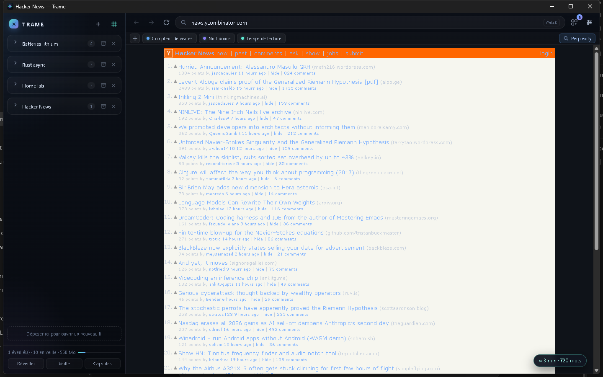

# Trame

**Un navigateur à onglets tissés, écrit en Rust.** Coquille `tao` + `wry` sur WebView2, interface
en HTML local, moteur d'extensions à manifeste.

> Un onglet n'est pas un document ouvert : c'est **un fil d'attention**. Trame mesure ce fil,
> l'affiche, l'endort quand il refroidit — et ne ferme jamais rien.



> **Le cours des évolutions** (ce qui a été construit, corrigé et vérifié, dans l'ordre) :
> [`docs/EVOLUTIONS.md`](docs/EVOLUTIONS.md). Les mesures de performance et les optimisations
> (faites ou refusées) : [`docs/OPTIMISATIONS.md`](docs/OPTIMISATIONS.md).

Le menu des extensions et la fenêtre d'une extension épinglée se posent **par-dessus la page**,
comme dans Chrome : la page ne bouge pas, reste visible autour, et un clic dessus referme la
fenêtre. La fenêtre d'une extension prend la taille de son contenu.


---

## Lancer

```powershell
cd D:\LIFE\10-projets\en-developpement\trame
cargo run --release
```

Prérequis : Rust stable (testé 1.94.1 MSVC), WebView2 Runtime (présent sur Windows 11),
Windows 10/11.

Le profil vit dans `%LOCALAPPDATA%\Trame` (`session.json`, `history.jsonl`, `ext-storage.json`,
`capsules\`, `extensions\`, `trame.log`). `TRAME_PROFIL` permet d'utiliser un autre dossier —
c'est ainsi que les essais se font sans toucher au profil réel.

```powershell
# essai sur un profil jetable, avec une session de démonstration
node outils/graine-session.mjs .profil-demo
$env:TRAME_PROFIL = "$PWD\.profil-demo"; cargo run
```

### Ajouter un fil d'onglets à un profil existant

```powershell
# Fermer Trame d'abord : la session est réécrite à l'arrêt.
node outils/ajouter-fil.mjs "$env:LOCALAPPDATA\Trame" outils/home-lab.json
```

`outils/home-lab.json` contient les adresses réelles du home lab, **vérifiées le 2026-11-21**
(port ouvert + réponse HTTP). Les onglets sont ajoutés **en veille** : treize services coûtent
zéro mémoire tant qu'on n'en ouvre pas un. Un fil de même nom déjà présent est remplacé.

## Ce qu'il fait

| Mécanisme | Ce que ça change |
|---|---|
| **Les fils** | Chaque onglet rejoint un fil — jamais par domaine seul : provenance (l'onglet parent), domaine, proximité lexicale des titres, fraîcheur du fil. Un fil a un nom, une durée de vie, et survit aux redémarrages. |
| **Ranger les fils** | On glisse la tête d'un groupe (nom, compteur) au-dessus ou au-dessous d'un autre : un trait dit où il tombera. L'ordre est celui de `session.fils`, donc il tient au redémarrage et les deux vues restent d'accord — les cartes du rail et les bandes de la trame. Déposer sur sa propre place ne demande rien à l'hôte. |
| **La vitalité** | Score continu par onglet : il monte quand vous y revenez, décroît avec le temps (demi-vie 8 min). Affiché comme un nœud lumineux sur la chaîne du fil. **Il ne déplace jamais un onglet** : la position acquise est stable. |
| **La mémoire basse** | Avant la veille, un palier : un onglet ouvert mais caché depuis 20 s rend sa RAM au système (WebView2 `MemoryUsageTargetLevel = Low`) sans se fermer, et revient à la normale au clic. Mesuré : −94 à −192 Mo de RAM avec 5 onglets cachés (`docs/OPTIMISATIONS.md` § 1.4). |
| **La mémoire libre** | Le nombre d'onglets ouverts est un plafond : sous 1,5 Go libre sur le PC, les plus froids s'endorment (jamais sous 2, jamais l'onglet affiché), et le pied du rail le dit (§ 1.5). |
| **Le coût des extensions** | Le puzzle et les réglages disent ce que chaque extension coûte en mémoire : mesuré en direct, ou par différence à son allumage (§ 1.6). |
| **La veille** | Sous le seuil, la webview est **détruite** (pas gelée) : la mémoire revient, l'onglet reste, un clic le réveille à sa position de lecture. Plafond de webviews vivantes par défaut : 6. |
| **La trame** (Ctrl+Espace) | Vue tissée : chaque fil est une bande, le temps va de gauche à droite, la taille d'un nœud dit la vitalité, un trait relie un onglet à celui d'où il vient. Glisser un nœud sur une bande le tisse dans ce fil. |
| **La Couture** (Ctrl+K) | Une seule saisie : onglets, fils, historique, commandes (`>`), ou adresse. Le classement mêle pertinence textuelle, **vitalité** et fraîcheur. |
| **Les fils cloisonnés** (bouclier dans l'en-tête d'un fil) | Un fil peut avoir **son propre profil** : connexions, cookies et **extensions** à part. Bitwarden seulement dans le fil « Comptes », uBlock partout ailleurs ; un compte ouvert dans la cloison ne l'est pas dans les autres fils. Le puzzle d'un fil cloisonné montre les extensions **de ce fil**. WebView2 n'active une extension que pour un profil entier, jamais pour un onglet : c'est donc la seule façon honnête d'avoir des extensions par fil. Prouvé par le scénario `t` (cookie invisible, extension présente ou absente selon le fil). |
| **Les capsules** | Un fil entier scellé dans un fichier JSON : URL, titres, position de lecture, mise de côté. Déplaçable, partageable, réouvrable. |
| **La barre d'extensions** | Sous la Couture : une pastille par extension (clic = activer/désactiver, **choix retenu au redémarrage**), un `＋` pour ouvrir le dossier, et le **moteur de recherche courant** à droite. Masquable depuis les réglages. |
| **Les réglages** (`Ctrl+,`) | Une vraie page interne (`trame://reglages`) : moteur de recherche parmi huit, gestion des extensions, veille et budget mémoire, historique, chemins du profil. Tout est enregistré à la volée dans `reglages.json`. |
| **Les extensions** | `manifest.json`, scripts de contenu, CSS, API `chrome.storage.local` persistante. Trois exemples livrés. |
| **Le menu de la page** (`⋯` à droite de la barre, ou clic droit sur un onglet du rail) | Tout ce qui s'applique à la page affichée : favori, impression, recherche, rendez-vous, fermeture programmée, côte à côte, guetteur, mémoire de lecture. |
| **Les favoris** (étoile dans la barre, `Ctrl+D`) | Une étoile pleine = page en favori. Ils sortent dans la barre dès qu'on tape leur nom, et en tuiles sur la page « Nouvel onglet ». Stockés dans `favoris.json`. |
| **Ouvrir dans le fil** (`Alt+Entrée` dans la barre) | L'adresse tapée s'ouvre dans un **nouvel onglet du fil où l'on est**, juste sous la page en cours, au lieu de la remplacer. `Entrée` seul garde son comportement. |
| **Le côte à côte** (`Maj+Entrée`, ou `Maj+clic` sur un onglet) | Deux pages dans la même fenêtre ; la séparation se fait glisser (20 à 80 %). Un clic dans une page la rend active. Option « défilement lié » pour comparer deux pages de même forme. |
| **Les rendez-vous** (menu de la page) | « Dans 1 h », « ce soir », « demain matin », « ce week-end », « lundi » : l'onglet **quitte le rail et s'endort** (zéro mémoire), puis revient seul à l'heure dite, marqué « revenu », avec un clignotement dans la barre des tâches. Une ligne en bas du rail liste ceux qui attendent. |
| **La fermeture programmée** | « Se ferme dans 1 h / 3 h / ce soir » : l'onglet part tout seul (`Ctrl+Maj+T` le rouvre). |
| **Le guetteur** (menu de la page → « Guetter un élément ») | On désigne un prix, un stock, un résultat : Trame relit la page **toutes les 30 min dans une page cachée et muette**, détruite aussitôt la lecture faite, jamais quand le PC manque de mémoire. Si le texte change : message « 39,90 € → 34,90 € », clignotement dans la barre des tâches, pastille sur `⋯`. Stocké dans `guets.json`. |
| **La mémoire de lecture** (`?` dans la barre) | Une page restée affichée 8 s est gardée **sur ce PC** (texte seul, 12 000 caractères au plus, 1 500 pages au plus). `? électrolyte solide` retrouve la page où vous l'avez lu, avec le passage. Jamais les pages qui ont un champ de mot de passe ; un site peut être exclu (et ce qui en avait été gardé est effacé) ; tout s'efface depuis les réglages. Le fichier (`lectures.jsonl`) n'est relu que pendant une recherche, par un fil à part : rien en mémoire vive. |
| **Le zappeur** (icône œil barré) | Panneau de droite : on désigne un élément dans la page (ou l'on colle un sélecteur CSS) et il disparaît. Règles **par domaine**, relisibles, coupables, supprimables, stockées dans `zap.json`. Livré avec 9 règles YouTube (Shorts, annonces) et 3 règles génériques. |

### Moteur de recherche

Huit moteurs au choix : **Perplexity** (défaut), Google, DuckDuckGo, Brave Search, Qwant,
Startpage, Ecosia, Bing. Les gabarits forcent la langue française quand le moteur l'accepte
(`kl=fr-fr`, `hl=fr&gl=fr`, `setlang=fr&cc=FR`) — sans cela, un moteur peut choisir sa langue
d'après l'adresse réseau et répondre en anglais. Le badge « fr » dans les réglages signale les
moteurs concernés.

> Le titre de l'onglet vient **du site** : « aliexpress at DuckDuckGo » est le titre de la page
> de résultats, pas une chaîne de Trame. Notre seule prise est la langue forcée dans l'URL et
> le moteur choisi.

### Raccourcis

| Touche | Effet | Touche | Effet |
|---|---|---|---|
| `Ctrl+T` | nouvel onglet | `Ctrl+W` | fermer l'onglet |
| `Ctrl+Maj+T` | rouvrir le dernier fermé | `Ctrl+K` / `Ctrl+L` | la Couture |
| `Ctrl+Espace` | la trame | `Ctrl+B` | replier le rail |
| `Ctrl+R` / `F5` | recharger | `Ctrl+Tab` | onglet suivant |
| `Ctrl+,` | réglages | `Ctrl+1…9` | onglet n° n |
| `Ctrl+ +` / `Ctrl+ -` | zoom avant / arrière (par onglet) | `Ctrl+0` | zoom à 100 % |
| `Ctrl+F` | chercher dans la page | `F12` | inspecteur (build debug) |
| `Ctrl+D` | ajouter / retirer des favoris | `Ctrl+P` | imprimer ou enregistrer en PDF |
| `Alt+Entrée` (barre) | ouvrir dans un nouvel onglet du fil | `Maj+Entrée` (barre) | ouvrir à côté de la page |
| `Maj+clic` (rail) | afficher l'onglet à côté | clic droit (rail) | menu de cette page |

Le zoom et la recherche dans la page sont **par onglet** : grossir un article ne grossit pas la
banque en ligne, et la barre de recherche se referme sur `Échap` en rendant le clavier à la page.

**Téléchargements** : un fichier demandé par une page va dans `%LOCALAPPDATA%\Trame\telechargements\`
(jamais écrasé — `rapport (2).pdf` au besoin), et l'application l'annonce. Sans ce branchement,
WebView2 ouvrait son propre panneau, invisible ici : le clic ne produisait rien.

## Où vit quoi

Tout ce dont le navigateur a besoin vit sous **`%LOCALAPPDATA%\Trame\`** (le profil). Rien ne dépend
de l'endroit où se trouve l'exécutable, et un `cargo clean` ne peut plus effacer une connexion.

```
%LOCALAPPDATA%\Trame\
├── ui\                        interface (miroir de la version livrée, mis à jour au démarrage)
├── extensions\                extensions Trame (amorcées une seule fois, modifiables)
├── extensions-chrome\         extensions Chrome actives
├── extensions-chrome-desactivees\   coupées, pas chargées
├── extensions-chrome-archives\      retirées ou remplacées — jamais effacées
├── webview2\EBWebView\        profil WebView2 : cookies, connexions, service workers
├── telechargements\           fichiers téléchargés (jamais écrasés)
├── capsules\                  fils scellés
├── session.json               onglets, fils, position
├── history.jsonl              historique (5000 entrées max)
├── reglages.json              moteur, veille, budget, état des extensions, épinglages
├── zap.json                   règles de masquage
├── ext-storage.json           stockage des extensions Trame
├── extensions-chrome-sources.json   d'où vient chaque extension
└── trame.log                  journal
```

**Pourquoi Local et pas Roaming.** Un profil de navigateur est une donnée de machine, pas de
compte : 355 Mo de caches, de cookies et de profils WebView2 n'ont rien à faire dans un dossier
itinérant, où ils suivraient chaque ouverture de session d'un poste à l'autre. Le profil vivait
dans Roaming par héritage ; il a été **déplacé** vers Local au premier démarrage (déplacement du
dossier entier, pas copie), et l'ancien n'existe plus.

Trois précisions, parce qu'elles ont coûté quelque chose :

- **L'interface est un miroir.** Un fichier retiré de la livraison disparaît du profil — une
  vieille copie de `chrome.js` avait déjà masqué un correctif. Un fichier identique n'est pas
  réécrit : un démarrage normal ne touche à rien.
- **Le profil WebView2 a été rapatrié**, pas recréé : au premier démarrage de cette version, les
  273 Mo de `trame.exe.WebView2` (à côté de l'exécutable) ont été copiés dans `webview2\`, et
  l'ancien dossier renommé `.migre` au lieu d'être supprimé. La connexion Bitwarden a survécu.
- **`TRAME_PROFIL` déplace tout** : c'est ce que les tests utilisent pour ne jamais toucher au
  vrai profil.

## Installer Trame

Deux livrables, produits par `node outils/faire-setup.mjs` et rangés dans `dist\` :

| Fichier | Pour qui |
|---|---|
| `Trame-<version>-setup.exe` (~2,8 Mo) | installation par utilisateur : `%LOCALAPPDATA%\Programs\Trame`, raccourci menu Démarrer, entrée « Applications », désinstalleur. **Aucun droit administrateur.** |
| `Trame-<version>-portable.zip` (~1 Mo) | sans installation : décompresser, lancer `trame.exe`. À replacer à côté de `ui\` et `extensions\`. |

`SHA256SUMS.txt` donne les empreintes des deux fichiers.

**Les deux sont signés** avec Azure Trusted Signing (compte `domoteek`, profil `MesApps`), via
l'outil partagé de l'écosystème `_tools\signature\signer.ps1` — le même que pour HydraNext. La
signature est horodatée (DigiCert) et `Get-AuthenticodeSignature` répond **Valid**, signataire
`CN=CAHAGNE CLEMENT`. L'ordre compte : **l'exécutable est signé avant la compilation du setup**,
sinon le client installe un exe non signé sous un setup signé.

> Les fichiers de `dist\` ont été refaits et **signés** le 2026-11-22 (0.4.10) : exe et setup
> `Valid`, horodatés (DigiCert), signataire `CN=CAHAGNE CLEMENT` ; empreintes dans
> `dist\SHA256SUMS.txt`. **`node outils/verifier-setup.mjs` n'a pas été rejoué** pour cette
> version : l'installation de Clément tournait pendant la fabrication, et ce contrôle
> installe puis désinstalle une copie (il écrit dans HKCU). À lancer juste avant ou juste après
> l'installation de la 0.4.10.

**Ce que l'installation ne fait pas** : ni elle ni la désinstallation ne touchent au profil
`%LOCALAPPDATA%\Trame`. Désinstaller Trame ne supprime pas les onglets, les réglages ni les
connexions — c'est écrit dans le `LISEZMOI.txt` livré.

Vérification de l'installation (installation silencieuse dans un dossier jetable, contrôle des
fichiers, de la signature, du raccourci et de l'entrée « Applications », lancement, désinstallation,
et contrôle que le profil réel n'a pas bougé) :

```powershell
node outils/verifier-setup.mjs
```

## Tester

Trois étages, trois commandes. Aucune ne touche au profil réel.

| Étage | Commande | Ce qui est vérifié | Mesure |
|---|---|---|---|
| Logique | `cargo test --release` | **177 tests** : ombre portée (opacité, coins, barre épargnée), une adresse unique dans la Couture, budget selon la mémoire libre, reconnaissance d'un processus d'extension, mémoire disponible mesurée, la cloison d'un fil sur le disque, l'ordre des fils (`deplacer_fil`, et sa relecture depuis le disque), icône d'extension et son confinement, réglages avec BOM, URL, géométrie, vitalité, tissage, protocole, persistance, modèle, CRX et identifiant d'extension, gestion et mémorisation des extensions, sort d'un téléchargement | ~0,3 s |
| Interface | `node outils/tester-ui.mjs` | **73 cas** : le coût des extensions dans le puzzle, la mémoire juste au pied du rail, l'interrupteur du budget automatique, le rail et le puzzle d'un fil cloisonné, l'interrupteur de mémoire basse, le menu puzzle (épingler, basculer, ouvrir, aucune reconstruction inutile), les icônes épinglées, le rangement des groupes au pointeur (le trait, le message unique, l'appui qui ne range rien, le rail replié, le gel du redessin), le DOM rendu par `ui/` à partir d'un état poussé, les messages envoyés à l'hôte, une injection XSS neutralisée, les 17 raccourcis clavier, et le contrat « tout message de l'interface est traité par l'hôte » | ~5 s |
| Installation | `node outils/verifier-setup.mjs` | **24 contrôles** : installation silencieuse, fichiers, signature `Valid`, raccourci, entrée « Applications », lancement, désinstallation, profil réel intact | ~40 s |
| Application | `node outils/verifier-app.mjs` | **19 scénarios** sur le binaire (22 avec `--reseau`) : mémoire libre faible (`u`), coût d'une extension mesuré (`v`, réseau), fils cloisonnés (`t`), mémoire basse des onglets cachés (`s`), chargement **à chaud** d'un CRX confirmé par le moteur, extinction puis rallumage à chaud (`r`), profil neuf, fichiers corrompus, adresse interne refusée, 30 onglets et budget, verrou de profil, zoom, téléchargement réel, zappeur appliqué par une page qui le rapporte, installation d'un CRX fabriqué, activation d'une extension mémorisée d'un démarrage à l'autre, `.crx` d'un autre site **non** installé — plus **2 en réseau** (`--reseau`) : installation depuis le magasin et clic « Ajouter à Chrome » | ~2 min |

Un geste a son propre banc d'essai, parce qu'un test d'interface ne prouve pas qu'un vrai geste
arrive jusqu'à l'hôte : **`node outils/eprouver-rangement.mjs`** envoie un vrai glissement de
souris par CDP (`Input.dispatchMouseEvent`) dans le rail du binaire, puis relit l'ordre des cartes
et `session.json` (profil jetable, fenêtre cachée, `--exe` pour essayer une construction de debug).

L'étage « application » crée un profil sous `%TEMP%` par scénario, lance `target\release\trame.exe`,
puis lit `trame.log` — la seule trace disponible en release. Les scénarios `i` à `m` prouvent des
choses que rien ne prouvait avant : que `SetZoomFactor` répond, qu'un fichier en pièce jointe
arrive bien dans le dossier, et qu'une règle du zappeur **masque réellement** l'élément (la page
de test rapporte son `display` calculé). Le scénario `o` allume une extension livrée **éteinte**,
redémarre le binaire, et exige une preuve d'injection réelle : le script de contenu écrit dans
`chrome.storage.local` l'adresse où il s'est exécuté, et le test relit `ext-storage.json`. Le
scénario `q`, en réseau, suit le clic « Ajouter à Chrome » : le magasin fait télécharger le `.crx`
par WebView2, et Trame doit l'installer sous l'identifiant du magasin.

Sondes de diagnostic, utilisées par ces tests :

```powershell
$env:TRAME_PROFIL = "$env:TEMP\essai"    # profil jetable
$env:TRAME_NAV   = "https://exemple.fr"  # navigue l'onglet actif au premier battement
$env:TRAME_ZOOM  = "1.3"                 # applique un zoom et le journalise
$env:TRAME_PANNEAU = "<id d'extension>"  # ouvre la popup de l'extension dans le panneau droit
$env:TRAME_EXT_ETAT = "<id>"             # allume une extension Trame au démarrage (`=off` la coupe)
```

## Mesures (poste de Clément, 2026-11-20)

| État | Mémoire | Processus |
|---|---|---|
| 1 onglet réveillé (11 onglets en session) | **660,7 Mo** | 10 |
| 6 onglets réveillés | **1 218,8 Mo** | 15 |

Soit **≈ 112 Mo et 1 processus de rendu par onglet réveillé**. C'est la justification chiffrée de
la veille : elle détruit la webview au lieu de la geler, et l'effet est immédiat et mesurable.
La réponse de l'application elle-même (pied du rail) affiche ce budget en continu — aucune API
WebView2 ne donne la mémoire *par onglet*, donc Trame affiche le total réel de ses processus
plutôt qu'un chiffre inventé.

## Extensions

```jsonc
{
  "name": "Nuit douce",
  "version": "1.0.0",
  "matches": ["*://*/*"],
  "css": ["style.css"],
  "js": ["contenu.js"],
  "run_at": "document_end"
}
```

Le dossier `extensions/` du dépôt est copié dans le profil au premier lancement. Une extension
cassée n'empêche pas les autres de se charger ; les motifs impossibles sont signalés au journal.
Spécification complète : [`docs/FORMAT-EXTENSION.md`](docs/FORMAT-EXTENSION.md).

**L'état d'une extension est retenu.** Le manifeste ne donne qu'un défaut (`enabled_by_default`) ;
allumer ou éteindre une extension depuis la barre ou les réglages écrit ce choix dans
`reglages.json` (`extensions_etat`), et c'est lui qui s'applique au démarrage suivant — dans les
deux sens. Une extension livrée éteinte qu'on allume reste donc allumée. Le journal le dit :
`extension <id> : activee (choix memorise)`, puis `extensions : N active(s) sur M`.

Trois exemples, volontairement différents :

- **Nuit douce** (`nuit-douce`) — feuille de style seule : adoucit les pages claires.
- **Temps de lecture** (`temps-lecture`) — lit le DOM, estime la durée, et retient votre choix de masquer la pastille.
- **Compteur de visites** (`compteur-visites`) — tient un compte par site dans `chrome.storage.local`, persisté entre les sessions.

## Deux moteurs d'extensions

Trame en a **deux**, et c'est assumé :

| | Format Trame | **Extensions Chrome (WebView2)** |
|---|---|---|
| Où | `%LOCALAPPDATA%\Trame\extensions\` | `%LOCALAPPDATA%\Trame\extensions-chrome\` |
| Manifeste | le nôtre (`matches`, `js`, `css`) | **v2/v3 de Chrome**, tel quel |
| Moteur | injecteur maison (fin de chargement) | **celui de Chromium** (`AddBrowserExtension`) |
| Ce qu'on a | scripts de contenu, CSS, `chrome.storage.local` | scripts de contenu, **service worker**, page d'action, API `chrome.*` |
| Ce qu'on n'a pas | page d'arrière-plan, `webRequest`, `tabs` | vérification de signature du magasin |
| Gestion | réglages → Extensions | réglages → **Extensions Chrome** |

Le premier est documenté dans [`docs/FORMAT-EXTENSION.md`](docs/FORMAT-EXTENSION.md), le second
dans [`exemples-chrome/LISEZMOI.md`](exemples-chrome/LISEZMOI.md).

### Installer une extension Chrome

Quatre voies — les trois premières depuis `Ctrl+,` → **Extensions Chrome**, la quatrième depuis le
magasin lui-même :

| Voie | Comment | Ce que Trame fait |
|---|---|---|
| **Magasin de Chrome** | collez l'identifiant (32 caractères) ou le lien de la fiche, puis **Installer** | télécharge le `.crx` sur le point d'entrée du magasin, retire l'en-tête de signature, décompresse, vérifie le manifeste |
| **Fiche du magasin** | ouvrez la page de l'extension dans Trame et cliquez **« Ajouter à Chrome »** | WebView2 ne sait pas installer depuis une page : il télécharge le `.crx`, et Trame le reprend pour l'installer (si le magasin a refusé de servir, l'identifiant est dans la redirection, et Trame retélécharge par son propre point d'entrée) |
| **Fichier local** | **Installer un fichier .crx / .zip…** | même chose, sans réseau |
| **Import** | **Chercher dans Chrome / Edge** → **Importer** | copie le dossier déjà décompressé d'un navigateur installé |

Un `.crx` téléchargé depuis **un autre site** n'est jamais installé en silence : il reste un fichier
dans `telechargements\` (la voie « fichier local » existe pour ça).

**Aucun redémarrage** : l'extension est chargée dans le moteur de WebView2 dès la fin de
l'installation (`ICoreWebView2Profile7::AddBrowserExtension`, piloté par `src/moteur_ext.rs`), puis
la page affichée est rechargée pour que ses scripts de contenu s'appliquent. Le téléchargement et
la décompression se font dans un fil annexe (`src/installation.rs`) : la fenêtre reste vivante —
avant, elle était figée 24 s pendant l'installation d'uBlock Origin Lite.

### Comme dans Chrome : le puzzle et les épingles

Le bouton **puzzle** de la barre ouvre le menu des extensions : une ligne par extension avec **son
icône**, son état réel (lu dans le moteur : « Active », « Désactivée »), une **épingle** et un
interrupteur. Un clic sur la ligne ouvre sa fenêtre d'action. L'épingle met l'icône de l'extension
dans la barre, juste à gauche du puzzle ; désactiver une extension masque son icône mais garde
l'épinglage, qui revient à la réactivation. Tout prend effet tout de suite.

#### L'identifiant, et pourquoi il compte

Chromium calcule l'identifiant d'une extension chargée **depuis un dossier** (c'est ce que fait
`AddBrowserExtension`) à partir de la clé publique `key` du manifeste — et **du chemin du dossier**
quand cette clé manque. Or les `.crx` du magasin ne portent pas `key` dans leur manifeste : la clé
voyage dans l'en-tête du CRX.

Trame la récupère donc là (CRX3, champ `signed_header_data` → `crx_id`, et la preuve dont
l'empreinte donne ce `crx_id`), l'inscrit dans le manifeste installé, et nomme le dossier avec
l'identifiant du magasin. Sans cela, une extension installée s'appelait `local-dark-reader` et
Chromium lui donnait l'empreinte du **chemin** : la fenêtre d'action demandée par l'interface
(`chrome-extension://<id>/…`) ne répondait pas.

> Mesure du 2026-11-21, dossier `mon-dossier` sans `key` : `chrome.runtime.id` =
> `cfmnfkohahigcphgcoimlckammkneabk` (empreinte du chemin). Le même dossier avec la clé du magasin :
> l'identifiant du magasin, `eimadpbcbfnmbkopoojfekhnkhdbieeh`.

Ce qui est vérifié le 2026-11-21 : un `.crx` **fabriqué par le test** (ZIP + en-tête CRX3) est
installé, extrait et rangé sous l'identifiant que Chromium calcule — SHA-256 de la clé publique du
manifeste, 32 lettres `a`–`p`, recoupé avec le `crypto` de Node ; l'extension réelle
**uBlock Origin Lite** s'installe depuis le magasin dans un profil jetable ; et le scénario `q`
suit le chemin complet d'« Ajouter à Chrome » (téléchargement par WebView2, décompression,
clé inscrite, provenance « magasin »).

**Ce que l'installation ne garantit pas** : la signature. WebView2 charge des extensions
décompressées, sans vérifier que le paquet vient bien du magasin. Trame le dit dans l'interface
plutôt que de laisser croire à une installation « validée ».

### Gérer une extension

| Bouton | Effet |
|---|---|
| **Interface** / **Panneau** | sa fenêtre d'action dans un onglet, ou dans le panneau de droite |
| **Épingler** / **Détacher** | son icône dans la barre du haut, qui ouvre la popup au clic |
| **Mettre à jour** | retélécharge la dernière version depuis le magasin (l'ancienne part aux archives, les données de l'extension sont gardées) |
| **Désactiver** / **Activer** | éteint ou rallume l'extension **tout de suite** dans le moteur (ses données, une connexion par exemple, sont gardées) et déplace le dossier entre `extensions-chrome\` et `extensions-chrome-desactivees\` pour le démarrage suivant |
| **Retirer** | la retire du moteur tout de suite et déplace le dossier dans `extensions-chrome-archives\` — le dossier n'est pas effacé |

Une extension déposée à la main **sans clé** dans son manifeste reçoit du moteur un identifiant
calculé sur son chemin, pas le nom de son dossier : Trame la retrouve alors par son nom.

Chaque ligne affiche ce que l'extension **demande** (permissions traduites : « toutes les pages »,
« lecture du trafic réseau », « stockage local »…), sa provenance (magasin, fichier, import) et son
poids sur le disque. Les noms et descriptions sont lus dans `_locales\`, avec le français
préféré quand l'extension le fournit.

**Comment ça flotte au-dessus de la page.** Chaque webview est une fenêtre fille Win32 ; wry les
crée sans `WS_CLIPSIBLINGS`, si bien que deux webviews qui se chevauchent se dessinaient dans un
ordre quelconque — d'où l'ancienne règle « jamais de superposition ». Trame leur donne ce style,
puis règle l'ordre d'empilement (fenêtre d'extension, puis barre, au premier plan) et découpe la
barre agrandie par une **région de fenêtre** : la ligne du haut plus la colonne du menu, coins bas
arrondis. Autour, la page se voit et reçoit les clics (`src/fenetres.rs`). L'**ombre** portée
vient d'une fenêtre transparente à part, traversée par les clics, qui dessine un anneau d'ombre
autour du menu (`src/ombre.rs`) — la technique des ombres de menus de Windows.

Sonde de diagnostic, quand vérifier ce panneau à la souris devient trompeur :
`$env:TRAME_PANNEAU = "<id d'extension>"` l'ouvre au démarrage et le journalise.
`$env:TRAME_NAV = "<adresse>"` navigue l'onglet actif au démarrage — c'est ainsi qu'on éprouve
le refus d'une adresse interne sans cliquer au pixel près.

**Adresses internes de Chromium** (`chrome-search://`, `chrome://`, `devtools://`…) : WebView2
les refuse (`ERR_INVALID_URL`) et la webview reste **bloquée** sur une page morte. Trame refuse
donc la navigation avant qu'elle n'ait lieu (la page reste en place, avec un message), ne
restaure jamais une telle adresse, et ouvre dans un onglet ce qu'une page demande par
`window.open` — au lieu de laisser la vue finir sur la page d'accueil interne du moteur.

Deux réserves mesurées : ces extensions s'appliquent **aussi au rail et à la barre** (ce sont des
pages web — une bannière en position fixe peut les recouvrir), et celles qui dépendent d'une API
que WebView2 n'expose pas restent inertes.

> Vérifié le 2026-11-21 : une extension MV3 de contrôle (`exemples-chrome/preuve-chrome/`) affiche
> sa bannière avec son `chrome.runtime.id` — donc c'est bien le moteur de Chromium qui exécute le
> code, pas l'injecteur maison.

## L'icône

Le glyphe de Trame — l'astérisque tissé du rail : trois fils (menthe, bleu, violet) qui se
croisent, avec un nœud à chaque extrémité. Elle se simplifie en **monochrome sous 32 px**, où
trois couleurs de 2 px ne se distinguent plus.

```
ressources/trame.ico          10 tailles (16, 20, 24, 32, 40, 48, 64, 96, 128, 256)
ressources/icones/*.png       une image par taille, fond transparent
ressources/trame-64.rgba      pixels bruts pour l'icône de fenêtre (tao)
```

- `build.rs` intègre le `.ico` dans l'exécutable (barre des tâches, explorateur, alt-tab).
- `main.rs` pose aussi l'icône sur la fenêtre, sinon la barre de titre garde celle du runtime.
- Régénérer : `node outils/faire-ico.mjs` après avoir re-rendu les PNG.

## Ce que ce n'est pas

Trame n'embarque **aucun moteur de rendu** : il pilote WebView2/Chromium. Ce n'est donc pas un
navigateur « de zéro » comme Servo ou Ladybird, et il n'a pas leur indépendance. C'est une
**coquille de navigation** : c'est le lieu où la gestion d'onglets est décidée, et c'est là que
Trame apporte quelque chose.

Il n'y a **pas** de page d'arrière-plan, de `webRequest`, ni d'API `tabs` dans les extensions,
et l'injection se fait en fin de chargement (`document_end`) — `document_start` est refusé
explicitement plutôt que silencieusement ignoré.

## Documentation

- [`docs/CONCEPT.md`](docs/CONCEPT.md) — la thèse, les mécanismes, et **ce qui existe déjà chez les autres** (état de l'art sourcé, 2025-2026).
- [`docs/ARCHITECTURE.md`](docs/ARCHITECTURE.md) — modules, protocole `trame:`, IPC, cycle de vie des webviews, sécurité, et les pièges qui ont coûté du temps.
- [`docs/FORMAT-EXTENSION.md`](docs/FORMAT-EXTENSION.md) — le manifeste et l'API `chrome` réellement disponible.

## Structure

```
src/
  main.rs        boucle d'evenements, fenetre, fils de battement et de mesure
  app.rs         le coeur : onglets, fils, commandes, IPC, extensions
  model.rs       types persistes (onglet, fil, capsule, session, manifeste)
  vitality.rs    score d'attention : decroissance, recharge, seuils
  weave.rs       tissage : provenance, domaine, lexical, nommage, suggestion de fusion
  search.rs      la Couture : pertinence floue + classement par vitalite et fraicheur
  extensions.rs  manifeste, motifs d'URL, injection, amorce de l'API chrome
  protocol.rs    protocole trame: (l'interface n'est JAMAIS servie en file://)
  shell.rs       geometrie des trois zones, en pixels physiques
  profile.rs     session, historique, capsules, stockage : ecritures atomiques
  probe.rs       mesure memoire reelle (processus + descendants)
  urls.rs        saisie -> URL, domaine enregistrable, affichage court
  log.rs         journal fichier + stderr
ui/              chrome.html/css/js, newtab.html, reglages.html, trame.html
extensions/      trois exemples (livres avec l'application)
ressources/      icone : trame.ico (10 tailles), PNG par taille, 64x64 RGBA pour la fenetre
outils/          graine de session, ajout d'un fil d'onglets (ajouter-fil.mjs + home-lab.json),
                 pilote de fenetre, mesure memoire, fabrication de l'ico
docs/            concept, architecture, format d'extension, captures
```

## Licence

MIT.
